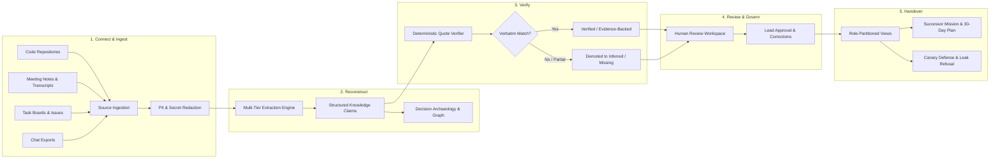

# BATON – Project Continuity Intelligence Platform

> **Problem Statement Alignment:** *Prevent Critical Knowledge From Leaving With People*  
> **Team:** MH12 | **Round:** 2 (The Build)  
> **Tagline:** *Pass the project, not just the files.*

BATON is a permission-aware, evidence-grounded **Project Continuity Intelligence Platform** designed to solve knowledge loss when key team members exit engineering teams, student initiatives, or volunteer organizations.

When people leave, documentation only captures final outcomes—the reasoning behind architectural decisions, abandoned alternatives, unwritten operational workarounds, task ownership, and informal dependencies walk out the door. BATON ingests scattered project communications and records, reconstructs project state into independent structured claims, verifies every claim with verbatim quotes, and compiles verified, role-partitioned handovers with zero ungrounded assumptions.

---

## 1. Core Workflow: From Scattered Activity to Verified Handover

BATON implements the complete 5-stage handover lifecycle specified in the challenge brief:

---

## 2. Key Architectural Innovations

### 1. Grounded Claim Extraction with Verbatim Verification
Conventional LLM summaries hallucinate plausible details and flatten critical nuance. BATON decomposes ingested documents into isolated, verifiable knowledge claims across 12 distinct categories:
- **Decisions & Decision Rationale:** Why a choice was made, what alternatives were rejected, and what trade-offs were accepted.
- **Task Ownership & Blockers:** Who owns what, what cannot proceed, and where dependencies lie.
- **Recurring Problems & Operational Risks:** Known failure modes and undocumented workarounds.
- **Important Contacts & Credential References:** Who holds access and where administrative control resides.

Every extracted claim is paired with an `exact_quote` from the source chunk. The **Deterministic Verifier** checks whether that quote exists character-for-character in the source chunk. If a quote is paraphrased, invented, or incomplete, the claim is automatically demoted to `Inferred` or `Missing` and flagged for human review. **No unverified assumption is ever presented as factual.**

### 2. Resilient Multi-Tier LLM Architecture
To ensure zero service interruptions during high-load periods or API rate limits, BATON deploys a three-tier extraction architecture:
1. **Primary Tier (OpenRouter Free Gateway):** Dynamically routes extraction requests to high-performance open LLMs without API billing overhead.
2. **Fallback Tier 1 (Gemini 3.8 Flash):** High-speed structured extraction via Google Generative Language interactions endpoint.
3. **Fallback Tier 2 (Deterministic Offline Pattern Matcher):** A rule-based regex and linguistic parser that extracts verbatim decisions, blockers, contacts, and risks directly from raw text with 100% offline availability and zero crash risk.

### 3. Role-Partitioned Access Control & Canary Leak Defense
Knowledge handovers must never leak information beyond a recipient's clearance:
- Ingestion automatically redacts PII and secrets via pre-processing before storage.
- The platform maintains four sensitivity tiers: `Public`, `Internal`, `Confidential`, and `Restricted`.
- Generated handover views compile strictly from source chunks the recipient is authorized to inspect.
- **Canary Penetration Defense:** Injected synthetic canary tokens are continuously monitored. The "Ask Your Project" RAG assistant enforces boundary checks and explicitly refuses to surface restricted canary data to lower-clearance roles.

### 4. Transparent Handover Readiness Scoring (0–100)
Rather than relying on subjective completion checklists, BATON computes a deterministic Handover Readiness Score derived mathematically from active database claims:

$$\text{Readiness Score} = 0.25 S_{\text{evidence}} + 0.20 S_{\text{ownership}} + 0.15 S_{\text{conflict}} + 0.15 S_{\text{dependency}} + 0.15 S_{\text{access}} + 0.10 S_{\text{review}}$$

- **Evidence Completeness ($S_{\text{evidence}}$):** Proportion of claims linked to verified source quotes.
- **Ownership Clarity ($S_{\text{ownership}}$):** Ratio of active components and tasks with verified primary and secondary owners.
- **Conflict Resolution ($S_{\text{conflict}}$):** Absence of contradictory decisions or diverging timelines.
- **Dependency Health ($S_{\text{dependency}}$):** Mapped upstream/downstream library, service, and external team links.
- **Access & Runbook Coverage ($S_{\text{access}}$):** Verified credentials, repository permissions, and deployment procedures.
- **Review Progress ($S_{\text{review}}$):** Sign-off percentage by authorized team leads.

> **Safety Gate:** Critical unresolved blockers or high-severity contradictions force the project status into **Blocked** or **At Risk**, preventing handover sign-off regardless of numerical score.

---

## 3. Platform Modules

| Module | Core Functionality |
| :--- | :--- |
| **Project Knowledge Graph** | Interactive topology visualizing team members, systems, decisions, files, and dependencies with live evidence inspect drawers. |
| **Decision Archaeology** | Structured timeline reconstructing decisions, rationale, participants, rejected alternatives, and reversal statuses. |
| **Project Risk Radar** | 8-dimension risk heatmap evaluating knowledge concentration, unconfirmed deadlines, architectural debt, and documentation gaps. |
| **Bus-Factor Intelligence** | Identifies critical single-person bottlenecks (Bus Factor = 1), orphaned modules, and targeted knowledge transfer priorities. |
| **Knowledge Drift Detector** | Compares historical baseline documentation against current commits and chats to highlight divergence in ownership, scripts, and choices. |
| **Living Runbooks** | Dynamic operational procedures (Setup, Deployment, Troubleshooting, Disaster Recovery) with inline verification and sign-off tracking. |
| **Successor Mission Mode** | 6-stage guided onboarding sequence (Architecture, Dependencies, Environment Setup, Simulation, Blocker Resolution, Production). |
| **Claim Ledger & Split Evidence** | Side-by-side audit interface displaying each extracted claim directly adjacent to highlighted source text. |
| **Ask Your Project RAG Assistant** | Permission-filtered conversational interface strictly grounded in verified citations with refusal of out-of-scope queries. |
| **Security & Canary Lab** | Automated penetration testing harness simulating direct extraction, paraphrased probing, and RAG injection attacks across role tiers. |
| **Multi-Role Collaboration Room** | Deliberation workspace uniting outgoing leavers, technical leads, and incoming successors around flagged items. |
| **Role-Partitioned Handover Compiler** | Generates tailored 30-day onboarding guides (Day 1, Week 1, Day 30) with cryptographic SHA-256 integrity receipt. |

---

## 4. Evaluation Profiles (Synthetic Project: "Project Aether")

The platform is pre-loaded with a comprehensive synthetic evaluation dataset (**Project Aether – Autonomous Robotics Platform**) covering cross-functional source transcripts, meeting decisions, GitHub issues, and architectural revisions.

Judges and evaluators can inspect different clearance perspectives across five pre-configured role profiles:

| Profile Role | Access Clearance | Intended Persona & Scope |
| :--- | :--- | :--- |
| **Admin** | Public, Internal, Confidential, Restricted | Complete system administration, governance, and audit visibility. |
| **Outgoing Leaver** | Public, Internal, Confidential, Restricted | Outgoing engineer reviewing and annotating reconstructed claims. |
| **Tech Reviewer** | Public, Internal, Confidential, Restricted | Team lead / reviewer approving decisions, runbooks, and sign-offs. |
| **Successor** | Public, Internal, Confidential | Incoming engineer viewing mission onboarding, runbooks, and safe context. |
| **Restricted Viewer** | Public, Internal | External partner or auditor with access limited strictly to non-confidential claims. |

---

## 5. Technology Stack

- **Frontend Application:** Next.js 14, TypeScript, Tailwind CSS, Lucide Icons, interactive SVG topology engines.
- **Backend Services:** FastAPI (Python 3.11/3.13), Pydantic v2 schemas, modular domain service architecture.
- **Persistence Layer:** PostgreSQL 16 on Neon Serverless Cloud (23 relational tables covering users, sources, chunks, claims, evidence, decisions, runs, and audit logs).
- **Intelligence & Parsing:** Multi-tier extraction adapter (OpenRouter API, Google Generative Language Interactions API, deterministic regex parsing), PyPDF parser, Presidio privacy scanning.
- **Security & Integrity:** Cryptographic SHA-256 handover receipt hashing, JWT role-based access control, synthetic canary token monitoring.
