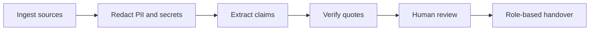

<p align="center">
  
</p>

<p align="center">
  <a href="https://frontend-ruddy-sigma-71.vercel.app/dashboard"><b>Live Demo</b></a> &nbsp;·&nbsp;
  <a href="#how-it-works">How it works</a> &nbsp;·&nbsp;
  <a href="#quick-start">Quick start</a> &nbsp;·&nbsp;
  <a href="#tests">Tests</a>
</p>

> **Problem statement:** *Prevent Critical Knowledge From Leaving With People* &nbsp;|&nbsp; **Team MH12** &nbsp;|&nbsp; Round 2 (The Build)

When someone leaves a team, documentation keeps the outcomes but loses the reasoning: why a decision was made, what was rejected, who really owns what, and which workarounds keep production alive.

**BATON** reads project sources, turns them into small claims, and checks every claim against a verbatim quote from the source. Anything it cannot prove is demoted, never presented as fact. The result is a reviewed, role-partitioned handover for the successor.

## How it works



1. **Ingest:** uploaded exports (docs, task-board CSVs, chat logs, PDFs) are chunked, hashed (SHA-256) and redacted.
2. **Extract:** an LLM splits the text into claims across 12 categories (Decision, Decision Reasoning, Task Ownership, Pending Task, Dependency, Blocker, Risk, Recurring Problem, Important Contact, Deployment & Access, Timeline Milestone, Open Question).
3. **Verify:** each claim must carry an `exact_quote`. A deterministic verifier checks it against the source (exact match, then whitespace-normalized match) and scores lexical support.
4. **Review:** people accept, edit or reject claims. Only reviewed claims reach `Verified`.
5. **Hand over:** the handover is compiled per role, with a Day 1 / Week 1 / Day 30 plan.

## What makes it different

- **Evidence or it doesn't count.** Claims end up as `Verified`, `Evidence-backed`, `Inferred`, `Conflict`, `Missing` or `Unverified`. A paraphrased or invented quote is demoted to `Inferred`.
- **Never goes down.** Extraction falls through four tiers: OpenRouter, then Gemini, then Claude, then an offline regex extractor that needs no API at all.
- **Permission-aware.** Four sensitivity tiers (`public`, `internal`, `confidential`, `restricted`). A claim inherits the most restrictive label of its evidence.
- **Leak-tested.** Canary tokens are redacted at ingestion, and the "Ask Your Project" assistant refuses canary and injection probes. A built-in Security Lab runs 5 attack scenarios against it.

## Readiness score

A deterministic 0-100 score computed from live database claims:

| Component | Weight |
| :--- | :---: |
| Evidence coverage (verified claims) | 25 |
| Ownership clarity | 20 |
| Conflict resolution | 15 |
| Dependency documentation | 15 |
| Access and runbook coverage | 15 |
| Human review completion | 10 |

**Safety gate:** any open *critical* risk forces **Blocked**; any unresolved conflict, or a score under 70, forces **At Risk**. Both make the handover non-deployable regardless of score. Otherwise 70+ is **High Confidence** and 85+ is **Ready**.

## Platform modules

| Area | What it gives you |
| :--- | :--- |
| **Knowledge Ledger** | Claims side by side with highlighted source evidence. |
| **Knowledge Graph** | People, systems, decisions and dependencies as an interactive map. |
| **Decision Archaeology** | Timeline of decisions, rationale and rejected alternatives. |
| **Risk Radar** | 8 categories: knowledge concentration, ownership, deadline, dependency, documentation, security, technical debt, unresolved decisions. |
| **Bus Factor** | Single-person bottlenecks and knowledge-transfer priorities. |
| **Drift Detector** | Where current activity diverges from the documented baseline. |
| **Living Runbooks** | Setup, deployment and recovery procedures with sign-off tracking. |
| **Gap Interview** | Targeted questions to the leaver for whatever is still missing. |
| **Successor Missions** | Guided onboarding tasks with progress and notes. |
| **Handover Center** | Role-partitioned handovers plus a comprehension quiz for the successor. |
| **Ask Your Project** | Permission-filtered Q&A that cites evidence and refuses out-of-scope queries. |
| **Trust & Security** | Role-based access, privacy scanning, audit log and the Security Lab. |

## Demo roles

The demo ships with **Project Aether**, a synthetic robotics project. Switch roles from the sidebar to see how clearance changes what is visible.

| Role | Max sensitivity | Purpose |
| :--- | :--- | :--- |
| Admin | restricted | Full governance and audit view |
| Reviewer | restricted | Approves claims, runbooks and handovers |
| Leaver | confidential | Reviews and annotates reconstructed knowledge |
| Successor | internal | Receives the handover and onboarding missions |
| Restricted Viewer | public | External or low-trust access |

## Tech stack

| Layer | Technology |
| :--- | :--- |
| Frontend | Next.js 14, React 18, TypeScript, Tailwind CSS, Recharts, Lucide |
| Backend | FastAPI, SQLAlchemy 2, Pydantic v2, JWT auth (bcrypt) |
| Database | PostgreSQL 16, 23 tables, auto-created on startup |
| AI | OpenRouter, Gemini, Claude, plus an offline deterministic extractor |
| Privacy | Regex and Shannon-entropy redaction for secrets, PII and canary tokens |

## Quick start

**Prerequisites:** Python 3.11+, Node.js 18+, PostgreSQL 16 with an empty database named `baton`.

```bash
# 1. Backend  (http://localhost:8000, API docs at /docs)
cd backend
pip install -r requirements.txt
cp .env.example .env          # set DATABASE_URL; API keys are optional
uvicorn app.main:app --port 8000

# 2. Frontend (http://localhost:3000)
cd frontend
cp .env.example .env.local    # NEXT_PUBLIC_API_URL=http://127.0.0.1:8000/api/v1
npm install
npm run dev
```

Tables are created and the Project Aether dataset is seeded automatically on first start. Use **Reset Demo** in the sidebar to restore it.

On Windows, `run_locally.bat` starts PostgreSQL, the backend and the frontend together (it expects PostgreSQL 16 in the default install path).

**Environment variables**

| Variable | Purpose |
| :--- | :--- |
| `DATABASE_URL` | PostgreSQL connection string |
| `JWT_SECRET` | Token signing key (change it outside local demos) |
| `OPENROUTER_API_KEY`, `GEMINI_API_KEY`, `ANTHROPIC_API_KEY` | Optional. With none set, the offline extractor is used |
| `NEXT_PUBLIC_API_URL` | Backend URL used by the frontend |

## Tests

```bash
cd backend
pytest
```

15 tests across four files cover password and JWT handling, quote verification, canary redaction and role-partitioned handovers, readiness scoring, the knowledge graph, assistant refusals, drift detection and the security simulator.

## Repository layout

```
backend/    FastAPI app: api/v1 routers, models, services, tests
frontend/   Next.js dashboard (src/app/dashboard/*)
assets/     README banner
```

---

<p align="center"><i>Pass the project, not just the files.</i></p>
